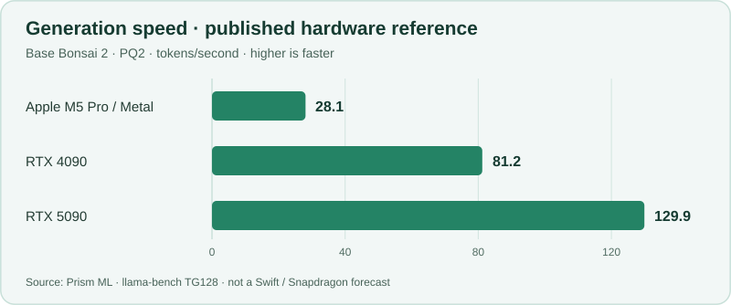
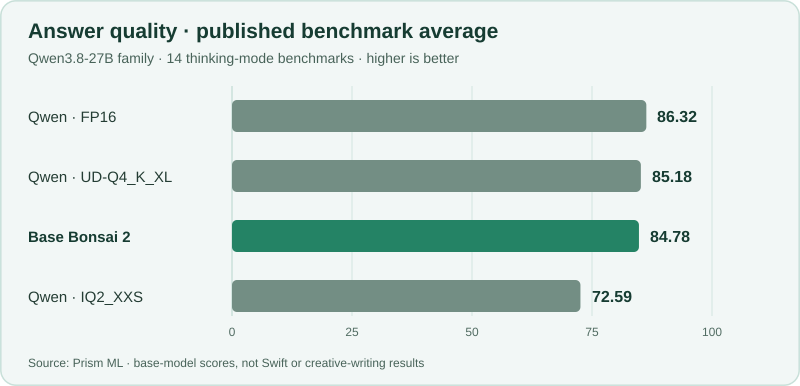

# 🌱 Swift Bonsai 2 - Runner

**A local runner for the Swift Bonsai 2 model on Windows ARM64.**

Creative writing · Brainstorming · Art direction

[Get started](docs/development-guide.md) · [Documentation](#documentation) · [TODO](PLAN.md)

---

Swift Bonsai 2 is a language model by [UkisAI](https://ukisai.com/swift-bonsai-2),
built on [PrismML's Bonsai 2](https://huggingface.co/prism-ml/Ternary-Bonsai-2-27B-gguf),
which derives from [Alibaba's Qwen3.8-27B](https://huggingface.co/Qwen/Qwen3.8-27B).

This project provides a local creative assistant for **Windows ARM64 laptops
with Snapdragon X and X2 processors**. It currently runs on the CPU, with
[automatic hardware tuning and GPU/NPU support](docs/hardware-capabilities.md#automatic-profile-selection)
planned.

The native Rust engine lives in [Prism Inference](https://github.com/symbiogenesis/prism-inference).
This project consumes a pinned prebuilt server; ordinary builds do not compile
the inference engine. Provision it with `bonsai-tools provision --json` using operation `inference` and an absolute `dataDirectory`; see the [setup commands](docs/development-guide.md#native-chat-app).

Once you've [set up the model and runtime](docs/development-guide.md#native-chat-app),
run `bonsai-tools chat --native-engine` to select the Rust engine, or
`bonsai-tools chat` for the publisher C++ default. Updating the Rust runtime
pin alone does not change that selection. Both open the native Windows chat app.

The convenience launcher `./scripts/Start-Chat.ps1` uses the same prebuilt Rust
tool; add `-NativeEngine` to select the Rust inference engine.

Keep separate conversations and unsent drafts, rename your chats, and find text
with **Ctrl+F**. Enable **Save conversations on this device** in Settings to
recover your workspace after closing; saved conversations use Windows user
encryption. Saving is off by default.

Thinking is off by default. Enable **Thinking** under **Settings → Response**
for the next response, including every Extra effort pass. Each conversation
keeps its own choice; optional conversation saving restores it.

Settings also adjusts the pinned abliteration adapter's strength for the next
response. The default scale is **1.3**; **0** disables its correction. Its effect
and output quality on Swift remain experimental.

You can chat with Swift, hear answers read aloud in a voice you describe, or
dictate a message to review before sending. The microphone stays off until you
turn it on and grant Windows permission. **Read aloud as responses arrive** reads
new answers while Swift writes; each response's speaker button remains available
for independent replay.

The launcher downloads speech models automatically. The setup guide explains
how to skip those downloads or preview the app without loading a model.
For developer details, see the [native Rust UI architecture](docs/ui-architecture.md)
and [local API contract](docs/broker-policy.md#public-request-contract).

## At a glance

| | Current target |
| --- | --- |
| **Hardware** | Snapdragon X and X2 · Windows ARM64 |
| **Model** | Swift Bonsai 2 · `PQ2_0` |
| **CPU profile** | One active request · 8K-token context · FP16 attention caches |
| **Outstanding work** | [Central TODO](PLAN.md) |

## Performance

| Model | Runtime | Tokens/second | Model file | Job commit cap / measured peak | Available RAM admission | Restore copy saved vs. Rust 0.1.4 |
| --- | --- | ---: | ---: | ---: | ---: | ---: |
| **Swift Bonsai 2 `PTQ1_0` (experimental opt-in)** | **Rust 0.1.13 release, four workers + LoRA 1.3** | **Not measured** | **5.54 GiB** | **11.5 GiB / 6.02 GiB (short request)** | **15.5 GiB** | **149.625 MiB** |
| Swift Bonsai 2 `PQ2_0` (verified Rust rollback) | Rust 0.1.13 release, four workers + LoRA 1.3 | Not measured | 6.71 GiB | 11.5 GiB / 7.20 GiB (short request) | 15.5 GiB | 149.625 MiB |
| Swift Bonsai 2 `PQ2_0` (experimental Rust) | Rust 0.1.10 prerelease, one worker + LoRA 1.3 | 0.105 (truncated request) | 6.71 GiB | 11.5 GiB / not recorded | 15.5 GiB | 149.625 MiB |
| Swift Bonsai 2 `PQ2_0` (experimental Rust) | Rust 0.1.10 prerelease, four workers + LoRA 1.3 | Pending (deadline) | 6.71 GiB | 11.5 GiB / not recorded | 15.5 GiB | 149.625 MiB |
| Swift Bonsai 2 `PQ2_0` (captured source diagnostic) | Rust 0.1.9, four workers + LoRA 1.3 | Not measured | 6.71 GiB | 11.5 GiB / 7.04 GiB | 15.5 GiB | 149.625 MiB |
| Swift Bonsai 2 `PTQ1_0` | PrismML C++ CPU | Not measured | 5.54 GiB | 11.5 GiB / — | 15.5 GiB | — |
| Swift Bonsai 2 `PQ2_0` (current default) | PrismML C++ CPU | Not measured | 6.71 GiB | 11.5 GiB / — | 15.5 GiB | — |
| Qwen3.8-27B `UD-Q3_K_XL` | llama.cpp reference | Not measured | 12.24 GiB | 18 GiB / — | 22 GiB | — |

The [bounded X2 Elite Extreme attempt](docs/evidence/native-request-speed.json)
measured eight reported output tokens in 76.21 s: **0.105 request tokens/second**,
including prefill and HTTP delivery through connection closure, excluding startup.
The eight-token cap truncated the answer (`finish_reason: length`); this measures
a short request, not decode TPS or a complete answer. The four-worker request
reached the shared soft deadline; its rate and the paired speedup remain pending.
Sustained decode TPS and PTQ1 speed remain unmeasured.

The [verified PTQ1 export](config/swift.ptq1-export.json) saves **1,259,520,000 bytes
(1.173 GiB)** on disk. The released service's full-context peak memory and paired benefit remain
unmeasured; the packing saving alone does not qualify resources or performance.

> [!NOTE]
> **PTQ1 is an experimental opt-in; qualification for the app default is pending.**
> Select the verified current-weight export with
> `bonsai-tools chat --native-engine --use-repacked-ptq1 --native-row-workers 4`
> after [provisioning it](docs/development-guide.md#runtime-selection).
> The [0.1.13 four-worker promotion score](docs/evidence/ptq1-promotion-bb020f4-service-90a62b9-review.json)
> retains **6 of 19 gates passed**, with 13 pending for frozen candidate `bb020f4`
> and separately reviewed service harness `90a62b9`.
>
> The [0.1.13 original-PQ2 rollback gate](docs/evidence/ptq1-rollback-41573164864/independent-review.json)
> passed with that released runtime, standard adapter, four-worker readiness,
> complete response, owned cleanup and verification of the retained original file.
> Both models returned `Oak` in the fixed-order comparison. Request times were
> **18.38 s for PQ2 and 35.73 s for PTQ1**; peak Job commit was **7.20 GiB and
> 6.02 GiB**, respectively. AC/battery status was not recorded, so these remain
> uncontrolled observations, with no performance or full-resource qualification.
>
> The [latest bounded four-worker service trial](docs/evidence/ptq1-service-41577882160/independent-review.json)
> passed three one-token-cap streams at scales 1.3, negative zero and 2.0, plus
> invalid-scale rejection. Its context-error check received no complete HTTP
> header and stopped before cancellation or fresh-owner replay. Parent-owned
> cleanup completed within **119.737 charged seconds**. AC was connected at the
> parent endpoints; the missing child after-power observation stays unknown.
> These partial checks do not qualify the full service gate, quality or throughput.
>
> The [published Prism 0.1.14 release](https://github.com/symbiogenesis/prism-inference/releases/tag/v0.1.14)
> includes the typed context-error fix. The [Runner pin preparation](docs/evidence/prism-0114-pin-preparation.json)
> binds its exact source and archive identities; owning Runner integration checks
> remain pending.
> The [combined service and original-PQ2 rollback profile](docs/validation.md#actual-model-application-acceptance)
> is prepared for one bounded allowance with adapter 1.3 and four workers.
> Actual 0.1.14 model/service/rollback acceptance remains pending. The earlier
> 0.1.13 measurements and gate passes retain their original identities.
>
> The [fresh hosted packing check](docs/evidence/ptq1-hosted-packing-b833d6b.json)
> independently matched all **209,920,000 blocks**, their original symbols and
> scales, and the preserved metadata and other tensor bytes. It reproduced the exact
> export with the pinned 0.1.13 exporter. Packing parity alone does not establish
> runtime numerical parity, memory use or speed.
>
> The [retained 0.1.13 source diagnostic](docs/evidence/ptq1-numerics-41568281287.json)
> matched all **39,504,384 logits and live-state values** byte for byte for one
> supplied token on X2 Elite Extreme, with explicit NEON, four row workers and
> adapter scale 1.3. Its **5.85 GiB peak Job commit** is specific to the correctness
> checker; it does not measure the released service's memory or throughput.
>
> Full-context/4K-output acceptance, scalar/explicit-NEON trajectories,
> loaded-zero identity, adapter authoring basis, paired complete-answer benefit,
> independent quality review and daily-service acceptance remain pending in
> [the plan](PLAN.md#actual-model-acceptance). PQ2 remains the app default and
> explicit rollback; the [release decision](docs/swift-memory.md#release-decision)
> retains the historical results and failures.
>
> Admission values are configured budgets including a 4 GiB physical reserve.
> The restore-copy figure describes a transient allocation lifetime. Mapped weight
> residency requires separate accounting from Job commit, and Windows, other
> applications, caching and speech need additional headroom.

See the [Swift memory assessment](docs/swift-memory.md) and
[Qwen reference accounting](docs/model-selection.md#source-only-compatibility-and-memory-sanity-check).

## Performance expectations

### Response speed

Compact weights can reduce memory traffic, but response speed also depends on
the hardware, runtime and prompt length. **Swift's sustained Snapdragon decode
rate remains unmeasured; the table above records one short-request rate.**
For context, these are Prism's published results for
the **base Bonsai 2 model**, using PQ2 weights on other hardware:

[Source: Prism throughput benchmarks](https://huggingface.co/prism-ml/Ternary-Bonsai-2-27B-gguf#cross-platform-throughput).
These are reference points, not a Swift or Snapdragon speed forecast. Thinking
time and long prompts also affect how soon a useful answer arrives.

### Answer quality

Prism reports **84.78** for base Bonsai 2 versus **86.32** for full-precision
Qwen3.8-27B across 14 thinking-mode benchmarks. The chart shows how that compares
with conventional compressed versions of the same Qwen base:

[Source: Prism benchmark results](https://huggingface.co/prism-ml/Ternary-Bonsai-2-27B-gguf#benchmarks).
These scores cover **base Bonsai, not Swift**, and do not measure creative-writing
quality. Swift's own publisher reports [uneven general-purpose behavior](https://ukisai.com/swift-bonsai-2#research-status-and-limitations).
Creative-writing quality and daily-service isolation still need qualification.
See [benchmark context and current limits](docs/performance-expectations.md).

## Documentation

The [documentation index](docs/README.md) maps every guide and technical contract.
Start with [setup and development](docs/development-guide.md),
[validation](docs/validation.md), or the [outstanding work](PLAN.md).
For design and research, use [application contracts](docs/README.md#application-contracts),
[models and runtime](docs/README.md#models-memory-and-runtime), and
[hardware and inference](docs/README.md#hardware-and-inference).

---

## License

Original project code, documentation, and configuration are licensed under the
[Apache License 2.0](LICENSE). Third-party code retains its own terms, including
the MIT-licensed Prism/ggml portions identified in [NOTICE](NOTICE).

Model weights and adapters are separate downloads governed by their publishers'
licenses. See the [license decision and dependency review](docs/licensing.md)
for scope, attribution, and redistribution requirements.
